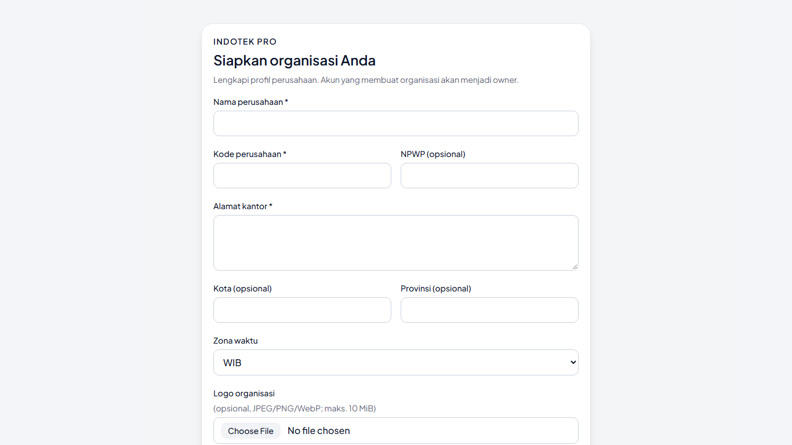
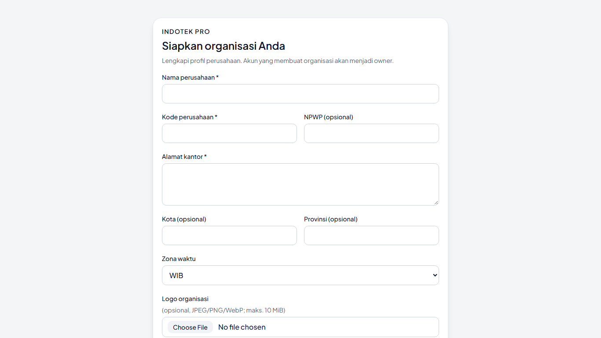

# Laporan Audit Overflow dan Responsivitas UI

## Ringkasan

Audit Playwright mencakup 15 route navigasi aplikasi beserta detail proyek, dialog pembuatan proyek, primitive overlay, autentikasi, dan onboarding. Route aplikasi serta overlay diuji pada delapan viewport dan tema terang/gelap; auth dan onboarding diuji pada sepuluh ukuran termasuk 375 px dan 1280 px.

Satu masalah nyata ditemukan pada onboarding organisasi di viewport 1366 × 768: bagian bawah form melewati area layar, sementara dokumen tidak bisa di-scroll. Tidak ditemukan horizontal overflow atau scroll dokumen/body ganda pada route navigasi yang diuji.

## Temuan

| ID | Keparahan | Area | Kondisi | Dampak |
|---|---|---|---|---|
| OV-01 | Sedang | Onboarding organisasi | Pada 1366 × 768, form berakhir sekitar y=866.75; tinggi viewport 768 px. Body global disetel `overflow: hidden`, sementara halaman onboarding belum memiliki scroller internal. | Tombol dan field di bagian bawah tidak dapat dijangkau. |

### Akar masalah dan perbaikan

Onboarding tidak mengikuti shell aplikasi yang menjadikan area konten sebagai satu-satunya pemilik scroll. Halaman onboarding kini memakai tinggi viewport tetap, `min-height: 0`, dan `overflow-y: auto`; konten tetap terpusat vertikal saat ruang cukup. Pengujian juga memastikan bahwa saat form melebihi viewport, pengguna dapat menggulir `main` hingga akhir form, tanpa memindahkan scroll ke `window`.

## Cakupan dan metode

- 15 route navigasi dan satu route detail proyek.
- Delapan viewport: 1920 × 1080, 1440 × 900, 1366 × 768, 1024 × 768, 768 × 1024, 430 × 932, 390 × 844, dan 360 × 800.
- Light dan dark mode; auth/onboarding juga mencakup 375 × 812 dan 1280 × 900.
- Mengukur lebar dokumen/body, pemilik scroll, batas main, serta scroll aktual melalui wheel.
- Memeriksa batas dialog proyek, alert dialog, sheet, tooltip, select, dropdown, dan popover.
- Trafik non-lokal diblokir pada audit route. Tidak ada mutasi data produksi.

## Bukti visual

Screenshot audit sebelum perbaikan dan sesudah perbaikan berada di [artifacts/ui-overflow/before](./artifacts/ui-overflow/before/) dan [artifacts/ui-overflow/after](./artifacts/ui-overflow/after/).

Perbandingan onboarding pada 1366 × 768:

Screenshot sebelum perbaikan mereproduksi layout sebelumnya dalam harness lokal yang terisolasi; screenshot sesudah diambil dari halaman yang diperbaiki. Bukti bagian bawah form yang dapat dicapai setelah scroll tersedia di `artifacts/ui-overflow/after/onboarding-1366-light-bottom.png`.

## Verifikasi akhir

Suite visual lulus 43/43; auth/onboarding lulus 2/2. Typecheck, lint, build, dan unit test (200/200) juga lulus. Detail verifikasi dan catatan build ada di [laporan akhir](./UI_OVERFLOW_FINAL_REPORT.md).

## Batasan audit

Satu resource HTTP 500 pada localhost pernah dilaporkan sebelum audit, tetapi tidak dapat direproduksi dalam suite terisolasi dan URL/penyebabnya belum teridentifikasi. Hal ini bukan temuan overflow dan perlu investigasi terpisah jika masih terjadi.
